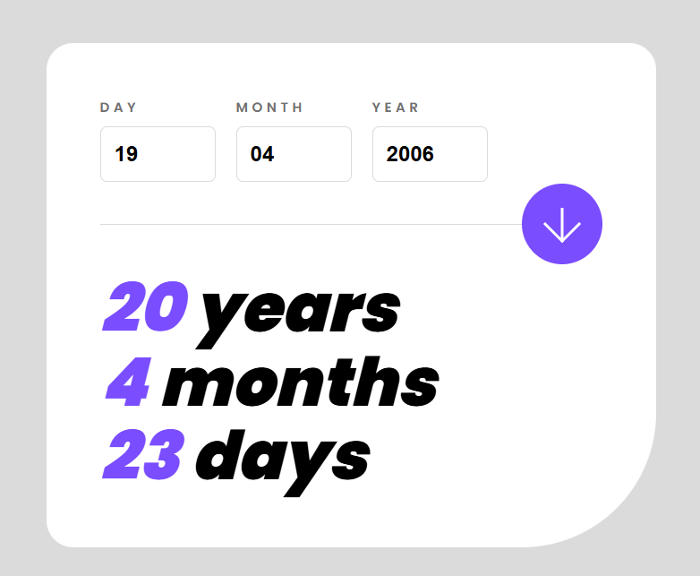

# Frontend Mentor - Age Calculator App

A responsive age calculator built with vanilla HTML, CSS, and JavaScript. Enter a date of birth and get back the exact age in years, months, and days — with full form validation and an animated count-up reveal.

## Features

- Calculates age in years, months, and days from a submitted date
- Custom validation: empty fields, out-of-range day/month, future years, and invalid dates (e.g. 31/04/1991)
- Fully responsive layout
- Accessible form (linked labels, ARIA label on the icon button)
- Custom submit icon built with CSS pseudo-elements, no icon library
- Bonus: animated count-up on the result numbers

## Built With

- Semantic HTML5
- CSS (custom properties, Flexbox, media queries)
- Vanilla JavaScript

## What I Learned

- Structuring validation with an `isValid` flag so multiple fields can show errors at once, instead of stopping at the first failure
- Real date math, including "borrowing" between days/months/years (same logic as regular subtraction borrowing)
- Using `new Date(year, month, 0).getDate()` to get the days in any month, leap years included
- Detecting invalid dates by checking if `new Date()` silently rolled over to a different date than what was entered
- Building icons with `::before`/`::after` pseudo-elements instead of an icon library
- Debugging a responsive layout bug caused by a label being wider than its own input
- Animating numbers with `setInterval`/`clearInterval`