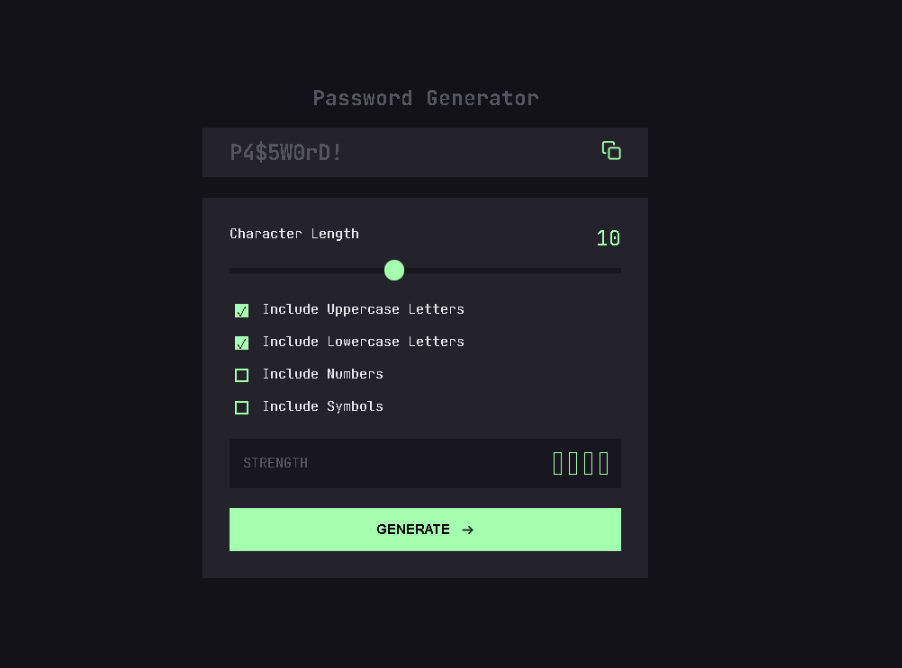

# Frontend Mentor - Password Generator App

A password generator built with vanilla HTML, CSS, and JavaScript. Pick a length, choose which character types to include, and generate a random password with a strength rating.

## Features

- Generates a random password from the selected options (uppercase, lowercase, numbers, symbols)
- Adjustable length with a slider
- Copy to clipboard, with a tick shown after copying
- Strength rating (weak, medium, good, strong) shown as a word and four bars
- Strength is based on both length and variety: the lower of the two decides the result
- Won't generate when no option is ticked or the length is 0
- Custom-styled slider and checkboxes
- Responsive layout, tested down to a small phone width
- Accessible form: linked labels, grouped checkboxes with a visually hidden legend, labelled icon button

## Built With

- Semantic HTML5
- CSS (Flexbox, custom form control styling)
- Vanilla JavaScript

## What I Learned

- Building a password with a loop and `Math.random()` plus `Math.floor()`
- Using guard clauses (`return`) to stop a function early when there is nothing valid to do
- Input values are always text, so `"0"` and `0` are not equal under `===`
- Combining two ratings into one with `Math.min()`
- Using `setTimeout` and `clearTimeout` so repeated clicks don't cut a timer short
- Selecting several elements with `querySelectorAll` and looping over them to fill the strength bars
- Using `fieldset` and `legend` for accessibility, and hiding the legend visually without `display: none`
- Styling a range slider and checkboxes with `appearance: none`